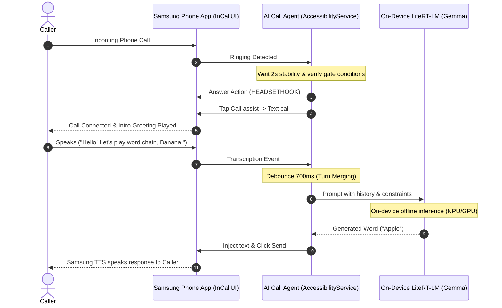

# AI Call Agent for Galaxy

[English](README.md) | [한국어](README_KO.md)

An open-source Android application that automatically answers and responds to phone calls by combining Samsung Galaxy **Text Call**, **Android AccessibilityService**, and an on-device **LiteRT-LM (Gemma)** model.

All AI inference runs 100% offline directly on your smartphone without external cloud servers or paid LLM APIs. The app has **zero network permissions** (`INTERNET` permission is completely omitted), ensuring that private conversations and phone call data never leave the device.

---

## Table of Contents
- [Why AI Call Agent Exists & Problems It Solves](#why-ai-call-agent-exists--problems-it-solves)
- [Key Features](#key-features)
- [How It Works & Privacy Architecture](#how-it-works--privacy-architecture)
- [Prerequisites](#prerequisites)
- [Installation & Build Guide](#installation--build-guide)
- [Step-by-Step Usage Guide](#step-by-step-usage-guide)
- [Usage Scenario Example](#usage-scenario-example)
- [Troubleshooting & FAQ](#troubleshooting--faq)
- [Project Architecture](#project-architecture)
- [Changelog](#changelog)
- [Additional Documentation & Resources](#additional-documentation--resources)
- [License & Notices](#license--notices)

---

## Why AI Call Agent Exists & Problems It Solves

### Motivation
For many reasons, there are situations where we cannot take calls directly. At times, we might wish an assistant could answer on our behalf to gather essential details. Samsung Galaxy's "Text Call" converts voice to text and synthesized speech, but it still requires the user to manually type out every response in real time—leaving significant challenges when driving, occupied with hands-on work, or away from the desk.

Existing cloud-based AI call assistants pose significant challenges:
1. **Privacy Risks**: Streaming raw call audio and transcripts to cloud servers risks exposing sensitive personal, corporate, or financial conversations.
2. **Cost and Connectivity Limits**: Recurring commercial API fees accumulate quickly, and services fail completely in poor signal or offline environments.

### The Solution: AI Call Agent
AI Call Agent aims to solve this problem by bridging **On-Device Small Language Models (SLMs)** with **Android Accessibility Services**:

- **Privacy Protection**: The app declares no network permission (`android.permission.INTERNET`). Speech processing, reasoning, and response generation occur entirely offline on your device chipset (NPU/GPU/CPU).
- **Fully Autonomous Cycle**: Manages incoming call detection, switching to Text Call, transcribing the caller's speech, generating context-aware answers, and injecting text safely—without human intervention.
- **Open-Source Reference**: Delivers a production-ready architectural pattern for connecting on-device SLMs with core mobile platform accessibility APIs.

---

## Key Features

1. **Safety-Gated Auto-Answer**
   - Multi-condition verification: Triggers only when Samsung incoming UI, matching caller label (`Incoming call` or `수신전화`), and the system `RINGING` state persist concurrently for **2 full seconds**.
   - Immediate cancellation: Reset timers whenever screens change, and executes exactly once per call.

2. **Automated Text Call Transition**
   - Dynamically locates and touches vetted Samsung UI buttons (`Call assist` / `통화 어시스트` → `Text call` / `텍스트 통화`) using coordinate-verified gestures.

3. **Real-Time Speech Transcription & Turn Debouncing**
   - Monitors caller utterances as text in real time.
   - Debounces incoming transcripts (700 ms stability window) to package fragmented speech into a coherent user turn before prompting the LLM.
   - Instantly cancels in-flight inference if the caller speaks further, combining utterances for refreshed context.

4. **On-Device Gemma Inference via `LiteRT-LM`**
   - Powered by Google's on-device runtime `LiteRT-LM` (`com.google.ai.edge.litertlm:litertlm-android:0.18.0`).
   - Executes pre-trained Gemma `.litertlm` models with hardware acceleration (GPU or CPU).
   - **Device Performance Dependency**: As an on-device AI model, token generation speed and Time to First Token heavily depend on the smartphone's chipset (AP/NPU/GPU) performance and memory bandwidth. Higher-end flagship devices deliver more natural and responsive turn transitions.
   - Enforces a 30-second inference timeout, 8,192 token context window, and 128 output token budget to maintain natural conversation pace.

5. **Send Verification & TTS Busy Handling**
   - Performs `ACTION_SET_TEXT` followed by `ACTION_CLICK` on verified send buttons.
   - Dual-checks that the input field has cleared and the local message count has incremented.
   - Catches Samsung Text Call "Cannot send while speech is playing" Toast notifications and automatically retries transmission every 2 seconds (up to 60 seconds).

6. **Default Demo Role: Word Chain Game**
   - Packaged with an interactive Word Chain Game prompt ([`CallConversation.java`](app/src/main/java/com/aicallagent/app/model/CallConversation.java)).
   - Supports relaxed Korean initial-sound rules (`두음법칙`), history tracking, 1-shot repair regeneration on invalid formats, and graceful loss/exit handling.
   - Bilingual support: Automatically adjusts to English word chain rules and 'Apple' test prompt under non-Korean system locales.

---

## How It Works & Privacy Architecture



### Privacy Principles
- **No Network Connectivity**: No `android.permission.INTERNET` declared in `AndroidManifest.xml`. Socket connections cannot be initiated.
- **Zero Logging Policy**: Call audio, full transcripts, phone numbers, and secrets are never logged to `Logcat` or stored in persistent storage (`SharedPreferences`, SQLite, etc.). If call recording is needed, Samsung Phone's built-in call recording feature can be utilized.
- **Strict Scope Boundaries**: Default accessibility filtering is restricted to Samsung telephony packages (`com.samsung.android.incallui`, `com.samsung.android.app.telephonyui`). If user text already exists in the input field, the agent aborts to prevent overwriting.

---

## Prerequisites

### 1. Device Requirements
| Item | Requirement | Notes |
| --- | --- | --- |
| **Device / OS** | Samsung Galaxy Smartphone / Android 12 (API 31) or higher | One UI Text Call supported devices (**Tested baseline: One UI 8.5 or higher**) |
| **RAM** | 8 GB RAM or higher | At least 3 GB available RAM for on-device SLM execution |
| **Storage** | 10 GB free space | For model weights (2 GB–6 GB) and internal cache safety headroom |
| **Tested Devices** | Galaxy S24+ (`SM-S926N`, One UI 8.5/9), Galaxy S26 Ultra (`SM-S948N`) | Validated under Korean and English system locales |

> [!NOTE]
> **One UI Version Note**: While Samsung Galaxy's Text Call feature is supported on earlier One UI releases, this project's accessibility UI node inspection and automation workflows have been verified on devices running **One UI 8.5 or higher**. Earlier versions may exhibit differences in Samsung Phone app layout or view IDs.

> [!TIP]
> **Device Performance Dependency**: Because LiteRT-LM utilizes on-device AP (NPU/GPU/CPU) resources, token generation throughput and turn latency directly reflect your smartphone's hardware specifications. Flagship devices with high-performance APs and the GPU backend are strongly recommended for seamless real-time conversation.

### 2. Build Requirements (When Building from Source)
- **JDK**: OpenJDK 21 (Required by `litertlm-android:0.18.0` bytecode; app compatibility targets Java 17)
- **Android SDK**: Platform 36 (`compileSdk 36`, `targetSdk 36`, `minSdk 31`), Build Tools 35.0.0+
- **Gradle**: Gradle 8.14.5 (Bundled `./gradlew` wrapper provided)
- **AGP**: Android Gradle Plugin 8.12.2

### 3. Model Files (`.litertlm`)
- Google AI Edge compatible Gemma model file (e.g. Gemma-2B-IT or Gemma-3B in `.litertlm` format)
- Official SHA-256 hash string for checksum verification

---

## Installation & Build Guide

### Step-by-Step Installation

#### 1. Clone the Repository
```sh
git clone https://github.com/your-username/AICallAgent.git
cd AICallAgent
```

#### 2. Set Up the Build Environment
Verify JDK 21 installation and set `JAVA_HOME`:
```sh
java -version
# Should output openjdk version "21.x.x"
```

#### 3. Run Unit Tests
Validate codebase integrity:
```sh
./gradlew :app:testDebugUnitTest
```

#### 4. Build the Debug APK
```sh
./gradlew :app:assembleDebug
```
The output APK is generated at:
`app/build/outputs/apk/debug/app-debug.apk`

#### 5. Install to Device
Connect your smartphone with USB debugging enabled:
```sh
# Install directly via Gradle
./gradlew :app:installDebug

# Or install manually via ADB
adb install app/build/outputs/apk/debug/app-debug.apk
```

> [!NOTE]
> This repository distributes only source code and the Gradle wrapper. Prebuilt APK binaries and proprietary model weight files (`.litertlm`) are not bundled.

---

## Step-by-Step Usage Guide

### Step 1: Prepare and Import Model
1. Download a compatible Gemma `.litertlm` model file from Google AI Edge official distribution sources (e.g., Kaggle or Hugging Face `litert-community`) after accepting terms of use.
2. Verify or calculate the SHA-256 hash using your terminal or checksum utility.
3. Transfer the model file to device storage (e.g., `Downloads` folder).
4. Open the AI Call Agent app → Tap **Local Gemma Model Settings** ([`LocalModelActivity.java`](app/src/main/java/com/aicallagent/app/local/LocalModelActivity.java)).
5. Paste the 64-character SHA-256 hash and tap **Select Model File** to import and copy it safely into internal storage.
6. Select backend (**GPU** recommended, or **CPU**) and tap **Prepare Model**.
7. Tap **Test Generation** to verify proper token generation (Korean: response to '사과', English: 'Apple' under rules).

### Step 2: Grant Permissions & Enable Accessibility
1. **Phone State Permission**: Allow `READ_PHONE_STATE` on the main screen (used solely for checking incoming call state and call termination).
2. **Accessibility Service**:
   - Open phone **Settings → Accessibility → Installed apps** (or Downloaded apps).
   - Find **AI Call Agent** and toggle it **ON**.
3. Return to the app main screen and confirm **Accessibility Service: Connected**.

### Step 3: Configure Samsung Text Call Initial Greeting (Recommended)
Open phone **Phone app → Settings (three dots) → Text call**:
- Toggle Text Call **ON**.
- Under Greetings -> **When switching to text call during voice call**, customize the initial announcement:
  > *“This call is answered by an AI Call Agent playing Word Chain.”*
- Designed to transition to Text Call after answering to accommodate call screening workflows.

### Step 4: Start Auto-Response
- On the main screen, tap **Turn On Auto Response**.
- Once model preparation completes, the status changes to **Listening for incoming calls**. The agent is now ready!

---

## Usage Scenario Example

### Word Chain Call Flow

```text
[Scenario: An incoming call arrives and connects]

1. [Incoming Call Gate]
   - Phone displays incoming call screen.
   - AI Call Agent waits 2 seconds for stability, then executes answer action.

2. [Screen Transition]
   - Automatically taps 'Call assist' -> 'Text call'.
   - Samsung Text Call greeting plays: "This call is answered by an AI Call Agent playing Word Chain."

3. [Turn 1: Caller Speaks]
   - Caller (voice): "Hello! Let's play. Banana!"
   - Text Call transcribes: [Banana] (Debounced after 700ms).

4. [Turn 1: AI Inference & Response]
   - On-device Gemma inference: Last word 'Banana' -> Generates "Apple".
   - Injects 'Apple' into input box and clicks Send.
   - Samsung TTS speaks "Apple" back to the caller.

5. [Turn 2: Ongoing Turns]
   - Caller (voice): "Elephant!"
   - On-device Gemma generates: "Tiger" -> Sent and spoken.

6. [Call Termination]
   - Caller hangs up. Call dismissal screen detected; agent clears session and returns to listening.
```

---

## Troubleshooting & FAQ

### Q1. The phone rings, but the app does not auto-answer.
- **Check Accessibility Service**: Verify that `AI Call Agent` is active under [Settings → Accessibility → Installed apps]. Battery optimization may occasionally turn it off.
- **Phone State Permission**: Ensure `READ_PHONE_STATE` permission is granted on the main screen.
- **2-Second Safety Delay**: The incoming call screen must persist stably for 2 seconds. Touching the screen during this window resets the timer.
- **Default SIM**: In dual SIM setups, only calls on the primary voice SIM are currently monitored.

### Q2. Call answers, but it fails to transition to Text Call.
- Ensure your system language is set to **Korean** or **English** (supported UI labels).
- Check that `Call assist` and `Text call` buttons appear on your phone screen during active calls.
- Ensure the screen is unlocked (lock screen security policies may prevent accessibility touch gestures).

### Q3. Hash mismatch or crash during model import.
- Ensure the downloaded `.litertlm` file finished downloading completely and is not corrupted.
- Check that the SHA-256 hash string matches the calculated hex digest exactly (case-insensitive).
- **Storage Check**: The device must have enough space for the model file plus a copy in internal storage and at least 64 MiB safety headroom.

### Q4. Sending halts with "Cannot send while speech is playing" notice.
- Samsung Text Call temporarily blocks text input while TTS audio is playing out.
- AI Call Agent monitors for this specific Toast notice and automatically retries transmission every 2 seconds for up to 60 seconds until the TTS finishes.

---

## Project Architecture

```text
AICallAgent/
├── app/
│   ├── build.gradle                            # Module build configuration (compileSdk 36, Java 17)
│   ├── gradle.lockfile                         # Dependency lockfile
│   └── src/
│       ├── main/
│       │   ├── AndroidManifest.xml             # Permissions & service declarations (NO INTERNET)
│       │   ├── java/com/aicallagent/app/
│       │   │   ├── MainActivity.java           # Primary UI & diagnostic status dashboard
│       │   │   ├── CallAccessibilityService.java # Core AccessibilityService orchestrator
│       │   │   ├── SamsungCallUi.java          # Samsung InCallUI node lookup & action execution
│       │   │   ├── LlmStatusText.java          # State string localization mapper
│       │   │   ├── llm/                        # LLM connectivity & test state models
│       │   │   ├── local/                      # LiteRT-LM (Gemma) session runtime & prompt builder
│       │   │   ├── model/                      # Call state machine, incoming gate & send controllers
│       │   │   └── policy/                     # Samsung package validation, UI buttons & toast policies
│       │   └── res/                            # App layouts, icons, accessibility service XML configs
│       └── test/
│           └── java/com/aicallagent/app/       # Comprehensive JUnit4 unit test suite
├── gradle/wrapper/                             # Gradle Wrapper
├── build.gradle                                # Root build configuration
├── settings.gradle                             # Project module definition
├── gradle.properties                           # JVM properties
├── LICENSE                                     # Apache License 2.0
├── NOTICE                                      # Third-party notices, model terms & trademark disclaimers
├── README.md                                   # English README (this file)
└── README_KO.md                                # Korean README
```

---

## Changelog

### [v0.1.0] - 2026-10-28
- **Initial Open-Source Release**
- **Samsung Text Call Automation**: Implemented 2-second safe incoming call gate, automated transition via `Call assist` and `Text call` UI buttons.
- **On-Device AI Engine**: Integrated `LiteRT-LM` (`0.18.0`) with Gemma models and hardware acceleration (GPU/CPU).
- **Turn & Speech Control**: 700 ms transcript debouncing, dynamic turn merging, and real-time generation cancellation.
- **Delivery Verification**: Dual verification of input clearance and message counter increment, with Toast-aware TTS backoff retries.
- **Interactive Role Demo**: Korean Word Chain game engine (relaxed initial-sound rules, 1-shot repair loop) and English rules support.
- **Zero-Network Privacy Architecture**: Completely eliminated `INTERNET` permission and call logging.

---

## Additional Documentation & Resources

- **Google AI Edge & LiteRT**:
  - [Google LiteRT Documentation](https://ai.google.dev/edge/litert)
  - [Gemma On-Device Models Guide](https://ai.google.dev/gemma)

---

## License & Notices

- **Source Code License**: Released under the [Apache License 2.0](LICENSE).
- **Third-Party & Model Notices**: Refer to [NOTICE](NOTICE) for third-party software dependencies, Google Gemma Terms of Use, and trademark disclosures.
- **Disclaimer**:
  - 'Samsung', 'Galaxy', 'One UI', and 'Bixby Text Call' are trademarks of Samsung Electronics Co., Ltd. This project is an independent open-source effort and is not affiliated with, endorsed by, or sponsored by Samsung Electronics Co., Ltd. or Google LLC.
  - Users are solely responsible for compliance with local telecommunications and call recording laws in their jurisdiction, including notifying callers when an automated assistant answers.
