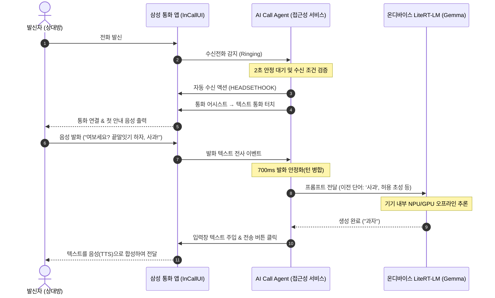

# AI Call Agent for Galaxy

[English](README.md) | [한국어](README_KO.md)

Samsung 갤럭시 스마트폰의 **텍스트 통화(Text Call)**와 **Android 접근성 서비스(AccessibilityService)**, 온디바이스 **LiteRT-LM (Gemma)** 모델을 결합해 전화를 자동으로 받고 응답하는 Android 오픈소스 앱입니다.

외부 서버나 유료 LLM API 없이, 스마트폰 내부에서 모든 인공지능 추론을 오프라인으로 실행합니다. 앱에는 `INTERNET` 권한이 일절 선언되어 있지 않아 사용자의 통화 내용과 개인정보가 외부로 유출될 위험을 근본적으로 차단합니다.

---

## 목차
- [프로젝트 존재 이유와 해결하는 문제](#프로젝트-존재-이유와-해결하는-문제)
- [주요 기능](#주요-기능)
- [동작 원리 및 프라이버시 보호](#동작-원리-및-프라이버시-보호)
- [사전 요구사항](#사전-요구사항)
- [설치 및 빌드 방법](#설치-및-빌드-방법)
- [사용 방법 및 단계별 가이드](#사용-방법-및-단계별-가이드)
- [사용 시나리오 예시](#사용-시나리오-예시)
- [문제 해결 (FAQ)](#문제-해결-faq)
- [프로젝트 구조](#프로젝트-구조)
- [변경 로그](#변경-로그)
- [추가 학습 자료 및 문서](#추가-학습-자료-및-문서)
- [라이선스 및 고지 사항](#라이선스-및-고지-사항)

---

## 프로젝트 존재 이유와 해결하는 문제

### 개발 배경
우리는 어떤 이유에서든 직접 통화하기 어려운 환경이 생깁니다. 때로는 나 대신 전화를 받아 필요한 정보를 파악해줬으면 하는 상황도 있습니다.  삼성 갤럭시의 '텍스트 통화'는 음성을 텍스트로 바꾸고 입력한 글자를 음성으로 읽어주지만, 통화 중 상대방의 말에 맞춰 실시간으로 직접 자판을 쳐야 하므로 운전 중이거나 손을 쓰기 어려운 상황, 자리를 비웠을 때는 여전히 한계가 있습니다.

또한, 기존의 클라우드 기반 AI 통화 비서는 다음과 같은 문제를 안고 있습니다:
1. **개인정보 침해 위험**: 실시간 통화 음성과 대화 전사본이 외부 클라우드 서버로 전송되어 민감한 개인정보나 금융 정보 유출 위험이 존재합니다.
2. **비용 및 네트워크 종속**: 상용 LLM API 요금이 지속적으로 발생하며, 네트워크 음영 지역에서는 서비스가 불가능합니다.

### AI Call Agent가 해결하는 방법
AI Call Agent는 **스마트폰 기기 자체에서 구동되는 온디바이스 소형 언어 모델(SLM)**과 **Android 접근성 서비스**를 결합하여 이 문제를 해결하고자 합니다.

- **프라이버시 보호**: 앱에 인터넷 연결 권한(`android.permission.INTERNET`)이 아예 없습니다. 모든 발화 분석과 답변 생성이 스마트폰 칩셋(NPU/GPU/CPU) 위에서만 오프라인으로 이루어집니다.
- **실시간 통화 자동 응답**: 전화 수신 감지부터 텍스트 통화 화면 전환, 상대방 발화 인식, 답변 생성 및 텍스트 자동 입력·전송까지 전 과정을 사람의 손길 없이 안전하게 수행합니다.
- **오픈소스 레퍼런스**: 온디바이스 LLM을 실제 모바일 시스템 서비스와 연동한 실용적인 오픈소스 아키텍처를 제공합니다.

---

## 주요 기능

1. **안전한 자동 수신 게이트**
   - 오작동 방지를 위한 다중 조건 검증: 삼성 수신 UI 컨테이너, 수신 문구(`수신전화` 또는 `Incoming call`), 기본 통신 회선의 시스템 `RINGING` 상태가 동시에 2초 이상 유지될 때만 자동 수신 동작을 수행합니다.
   - 단 1회 실행 보장 및 화면 이탈 시 즉시 취소: 연결·발신·종료 화면이거나 대기 중 화면을 벗어나면 즉시 타이머를 초기화합니다.

2. **텍스트 통화 자동 진입 제어**
   - 통화가 연결되면 검증된 삼성 통화 UI 버튼(`통화 어시스트` → `텍스트 통화`)의 실시간 좌표를 판별하여 안전하게 전환합니다.

3. **실시간 발화 전사 감지 및 턴 병합**
   - 상대방의 음성이 텍스트로 변환되는 과정을 실시간 모니터링합니다.
   - 발화가 700ms 동안 안정(debounced)되면 하나의 사용자 턴으로 묶어 LLM에 추론을 요청합니다.
   - 답변 생성 도중 상대방이 추가로 말을 이어가면 이전 추론을 즉시 취소하고 새 발화를 합쳐 재추론합니다.

4. **온디바이스 Gemma 기반 로컬 추론 (`LiteRT-LM`)**
   - Google의 최신 온디바이스 런타임 `LiteRT-LM`(`com.google.ai.edge.litertlm:litertlm-android:0.18.0`)을 탑재했습니다.
   - 사전 학습된 Gemma `.litertlm` 모델 파일을 기기에 직접 로드하여 CPU 또는 GPU 가속으로 초고속 오프라인 답변을 생성합니다.
   - **디바이스 성능 의존성**: 온디바이스 AI 특성상 토큰 생성 속도와 첫 답변 지연 시간(Time to First Token)은 스마트폰의 칩셋(AP/NPU/GPU) 성능과 메모리 대역폭에 크게 좌우됩니다. 고사양 플래그십 기기일수록 더 자연스럽고 빠른 턴 전환이 가능합니다.
   - 최대 30초 내 타임아웃 및 컨텍스트(8,192 토큰)·출력(128 토큰) 예산 관리로 안정적인 통화 템포를 유지합니다.

5. **답변 전송 검증 및 음성 재생 대기 처리**
   - 생성된 텍스트를 입력창에 설정(`ACTION_SET_TEXT`)하고 전송 버튼(`ACTION_CLICK`)을 실행합니다.
   - 입력창이 비워지고 실제 전송 메시지 수가 증가했는지 엄격히 교차 검증합니다.
   - 삼성 텍스트 통화의 TTS(음성 합성) 재생 중 발생할 수 있는 '음성 전달 중에는 전송할 수 없습니다' 대기 안내(Toast)를 실시간 감지하여, 음성 재생이 끝난 뒤 자동으로 전송을 재시도합니다.

6. **기본 시연 역할: 한국어 끝말잇기 게임**
   - 기본 시스템 프롬프트([`CallConversation.java`](app/src/main/java/com/aicallagent/app/model/CallConversation.java))에 양방향 한국어 끝말잇기 룰이 탑재되어 있습니다.
   - 완화된 두음법칙(`대로→노력`, `유럽→업보` 등) 적용, 사용한 단어 이력 관리, 형식 오류 시 최대 1회 수정 지침 기반 재생성(Repair loop), 항복(`[[LOSS]]`) 및 종료 선언을 스마트하게 처리합니다.
   - 다국어 지원: 영문 환경에서는 영문 끝말잇기 규칙 프롬프트 및 'Apple' 시험 생성 모드로 자동 전환됩니다.

---

## 동작 원리 및 프라이버시 보호



### 프라이버시 보호 원칙
- **네트워크 차단**: 앱의 `AndroidManifest.xml`에 `android.permission.INTERNET` 권한이 존재하지 않습니다. 어떠한 네트워크 소켓도 열 수 없습니다.
- **무기록 원칙**: 통화 원문, 상대방 발화 내용, 전화번호, 개인정보는 앱 로그(`Logcat`)나 영구 저장소(`SharedPreferences`, 로컬 DB 등)에 일절 저장되지 않습니다. 통화 녹음이 필요하다면 삼성 전화의 기능을 이용할 수 있습니다.
- **접근성 권한 최소화**: 기본 접근성 이벤트는 삼성 통화 관련 2개 패키지(`com.samsung.android.incallui`, `com.samsung.android.app.telephonyui`)로 엄격하게 한정됩니다. 사용자가 입력 중인 텍스트가 있을 경우 이를 덮어쓰지 않고 자동 응답을 즉시 중단합니다.

---

## 사전 요구사항

### 1. 실행 기기 요구사항
| 구분 | 필수 사양 | 권장 및 비고 |
| --- | --- | --- |
| **제조사/OS** | Samsung Galaxy 스마트폰 / Android 12 (API 31) 이상 | One UI 텍스트 통화 지원 기기 (**실기기 검증 기준: One UI 8.5 이상**) |
| **RAM** | 최소 8GB 이상 | 온디바이스 SLM 구동을 위해 가용 RAM 3GB 이상 필요 |
| **저장공간** | 최소 10GB 이상 여유 공간 | 모델 가중치 파일(2GB~6GB) 및 앱 내부 저장 공간 |
| **검증 완료 기기** | Galaxy S24+ (`SM-S926N`, One UI 8.5/9), Galaxy S26 Ultra (`SM-S948N`) | 한국어 및 영어 통화 환경 |

> [!NOTE]
> **One UI 버전 안내**: 삼성 갤럭시의 '텍스트 통화' 기능 자체는 하위 One UI 버전에서도 지원되지만, 본 프로젝트의 접근성 UI 노드 탐색 및 자동화 동작은 **One UI 8.5 이상** 기기에서 검증되었습니다. 하위 버전의 경우 삼성 전화 앱의 내부 뷰 ID나 화면 레이아웃에 차이가 있을 수 있습니다.

> [!TIP]
> **디바이스 성능 의존성**: 온디바이스 SLM(`LiteRT-LM`)은 기기 자체의 AP(NPU/GPU/CPU) 자원을 활용하므로, 토큰 생성 속도와 통화 턴 대기 시간은 스마트폰의 하드웨어 사양에 직접적인 영향을 받습니다. 원활한 실시간 통화 응답을 위해 고성능 AP가 탑재된 플래그십 기기 사용 및 GPU 백엔드 설정을 권장합니다.

### 2. 빌드 환경 요구사항 (소스 코드 직접 빌드 시)
- **JDK**: OpenJDK 21 필수 (`litertlm-android:0.18.0` 의존성 해석용, 소스 타깃은 Java 17)
- **Android SDK**: Platform 36 (`compileSdk 36`, `targetSdk 36`, `minSdk 31`), Build Tools 35.0.0+
- **Gradle**: Gradle 8.14.5 (프로젝트 내 `./gradlew` 래퍼 기본 제공)
- **AGP**: Android Gradle Plugin 8.12.2

### 3. 언어 모델 파일 (`.litertlm`)
- Google AI Edge 호환 Gemma 모델 파일 (예: Gemma-2B-IT 또는 Gemma-3B `.litertlm` 형식)
- 모델 파일의 공식 SHA-256 해시값 (무결성 검증용)

---

## 설치 및 빌드 방법

### 단계별 설치 가이드

#### 1. 저장소 복제 (Clone)
```sh
git clone https://github.com/your-username/AICallAgent.git
cd AICallAgent
```

#### 2. 빌드 환경 설정
JDK 21이 설치되어 있는지 확인하고 `JAVA_HOME`을 설정합니다.
```sh
java -version
# openjdk version "21.x.x" 확인
```

#### 3. 단위 테스트 실행
프로젝트의 무결성을 확인하기 위해 단위 테스트를 수행합니다.
```sh
./gradlew :app:testDebugUnitTest
```

#### 4. 디버그 APK 빌드
```sh
./gradlew :app:assembleDebug
```
빌드가 완료되면 다음 경로에 APK가 생성됩니다:
`app/build/outputs/apk/debug/app-debug.apk`

#### 5. 기기에 설치
USB 디버깅이 활성화된 스마트폰을 연결한 후 설치합니다.
```sh
# Gradle을 통한 직접 설치
./gradlew :app:installDebug

# 또는 adb를 통한 수동 설치
adb install app/build/outputs/apk/debug/app-debug.apk
```

> [!NOTE]
> 이 저장소는 소스 코드와 Gradle 래퍼만 배포하며, 사전 빌드된 바이너리(APK)나 모델 가중치(`.litertlm`)는 저장소에 포함되어 있지 않습니다.

---

## 사용 방법 및 단계별 가이드

### 단계 1: 모델 파일 준비 및 앱에 등록
1. Google AI Edge 공식 배포처(Kaggle 또는 Hugging Face `litert-community`)에서 약관 동의 후 호환되는 Gemma `.litertlm` 파일을 다운로드합니다.
2. 다운로드한 파일의 SHA-256 해시값을 확인하거나 터미널에서 직접 계산합니다.
3. 스마트폰의 다운로드 폴더 등으로 모델 파일을 전송합니다.
4. AI Call Agent 앱 실행 → **로컬 Gemma 모델 설정** 클릭.
5. 계산한 64자리 SHA-256 해시를 입력창에 붙여넣고 **모델 파일 선택**을 눌러 기기 내 모델 파일을 지정합니다. (앱 내부 저장소로 안전하게 복사 및 검증됩니다.)
6. 백엔드(권장: GPU, 기기 상황에 따라 CPU)를 선택한 뒤 **모델 준비**를 누릅니다.
7. 모델 준비 완료 후 **시험 생성** 버튼을 눌러 테스트 문장이 정상 출력되는지 확인합니다 (한국어 환경: '사과' 입력에 대한 답변 생성).

### 단계 2: 필수 권한 및 접근성 서비스 활성화
1. **전화 상태 권한 허용**: 앱 메인 화면에서 전화 상태 권한(`READ_PHONE_STATE`)을 허용합니다 (기본 통신 회선의 수신 및 통화 종료 상태 감지용).
2. **접근성 서비스 활성화**:
   - 스마트폰 **설정 → 접근성 → 설치된 앱 (또는 다운로드한 앱)**으로 이동합니다.
   - **AI Call Agent**를 찾아 **사용 중(켜기)**으로 변경합니다.
3. 앱 메인 화면으로 돌아와 **접근성 서비스: 연결됨**으로 표시되는지 확인합니다.

### 단계 3: 삼성 텍스트 통화 기본 안내 설정 (권장)
스마트폰의 **전화 앱 → 설정(우측 상단 점 3개) → 텍스트 통화** 메뉴로 이동합니다.
- 텍스트 통화 기능을 활성화합니다.
- 인사말 -> **음성통화 중 텍스트 통화로 전환할 때** 항목에서 첫 통화 멘트를 설정할 수 있습니다: 
  > *“이 전화는 에이전트가 받은 끝말잇기 통화입니다.”*
- 통화 스크리닝 사용을 고려해 전화를 받은 뒤 텍스트 전화로 전환되도록 되어 있습니다.

### 단계 4: 자동 응답 대기 시작
- AI Call Agent 메인 화면에서 **자동 응답 켜기** 버튼을 누릅니다.
- 모델 로드 및 준비 상태가 완료되면 화면에 **수신 대기 중** 표시가 나타납니다. 이제 전화가 오면 자동으로 동작합니다!

---

## 사용 시나리오 예시

### 끝말잇기 통화 시나리오

```text
[상황: 발신자가 전화를 걸어 통화가 연결됨]

1. [수신 감지] 
   - 스마트폰 화면에 전화 수신 화면 표시
   - AI Call Agent가 2초간 유효 수신 상태를 감지 후 통화 자동 수신

2. [화면 전환]
   - 통화 연결 화면에서 '통화 어시스트' → '텍스트 통화'로 자동 진입
   - 삼성 텍스트 통화 기본 음성 송출: "이 전화는 에이전트가 받은 끝말잇기 통화입니다."

3. [1턴: 상대방 발화]
   - 발신자 (음성): "안녕? 내가 먼저 시작할게. '비행기'!"
   - 화면 전사 확인: [비행기] 텍스트 인식 (700ms 후 확정)

4. [1턴: AI 추론 및 응답]
   - 온디바이스 Gemma 추론: 시작 글자 '기' 인식 → "기차" 생성
   - 입력창에 '기차' 자동 입력 후 전송 클릭
   - 삼성 음성 합성(TTS)이 발신자에게 "기차"를 음성으로 재생

5. [2턴: 연속 진행]
   - 발신자 (음성): "차표!"
   - 온디바이스 Gemma 추론: "표범" 생성 및 자동 전송
   
6. [통화 종료]
   - 상대방이 전화를 끊으면 종료 화면 감지 후 자동으로 세션을 정리하고 다음 통화 대기 상태로 복귀
```

---

## 문제 해결 (FAQ)

### Q1. 전화가 와도 자동으로 받아지지 않습니다.
- **접근성 서비스 확인**: 스마트폰 [설정 → 접근성 → 설치된 앱]에서 `AI Call Agent`가 켜져 있는지 확인하세요. 절전 모드나 시스템에 의해 꺼진 경우 다시 켜주어야 합니다.
- **전화 상태 권한**: 앱 메인 화면에서 전화 권한(`READ_PHONE_STATE`)이 허용되어 있는지 확인하세요.
- **2초 지연 시간**: 오작동 방지를 위해 수신 화면이 2초간 유지되어야 수신 액션이 동작합니다. 너무 일찍 수동 조작을 하면 타이머가 초기화됩니다.
- **기본 통신 회선**: 듀얼 SIM 환경인 경우 기본 데이터/통화 회선으로 설정된 전화만 자동 감지됩니다.

### Q2. 수신은 되는데 텍스트 통화 화면으로 전환되지 않습니다.
- 지원 기기 및 언어를 확인하세요. 현재 공식 지원 UI 언어는 **한국어** 및 **영어**입니다.
- 통화 수신 후 통화 화면에 `통화 어시스트` 및 `텍스트 통화` 버튼이 정상 노출되는 One UI 버전인지 확인하세요.
- 스마트폰 화면이 잠금 해제 상태인지 확인하세요 (화면 잠금 상태에서는 보안 정책상 제스처 터치가 제한될 수 있습니다).

### Q3. 모델 등록 시 해시 불일치 오류가 발생합니다.
- 모델 파일이 손상되었거나 다운로드가 덜 끝났을 수 있습니다.
- PC 또는 터미널에서 `shasum -a 256` 명령으로 직접 구한 64자리 16진수 소문자/대문자 해시와 정확히 일치하는지 확인하세요.
- 내부 저장 공간 부족: 모델 파일 크기(최대 6GiB) 외에 복사본을 위한 동일 용량 및 최소 64MiB 이상의 여유 공간이 필요합니다.

### Q4. "음성 전달 중에는 보낼 수 없습니다" 안내가 뜨면서 멈춥니다.
- 삼성 텍스트 통화는 이전 텍스트의 음성 합성이 재생되는 동안 새로운 텍스트 전송을 일시 차단합니다.
- AI Call Agent에는 이 상태를 진단하고 대기하는 로직이 내장되어 있습니다. 최대 60초 동안 2초 간격으로 전송을 자동 재시도하므로 음성 출력이 끝나면 정상 전송됩니다.

---

## 프로젝트 구조

```text
AICallAgent/
├── app/
│   ├── build.gradle                            # 모듈 빌드 설정 (compileSdk 36, Java 17)
│   ├── gradle.lockfile                         # 의존성 잠금 파일
│   └── src/
│       ├── main/
│       │   ├── AndroidManifest.xml             # 권한·액티비티·접근성 서비스 선언 (INTERNET 권한 없음)
│       │   ├── java/com/aicallagent/app/
│       │   │   ├── MainActivity.java           # 메인 UI 및 진단/상태 표시
│       │   │   ├── CallAccessibilityService.java # 통화 관찰 및 자동 제어 핵심 접근성 서비스
│       │   │   ├── SamsungCallUi.java          # 삼성 통화 UI 노드 식별 및 액션 실행
│       │   │   ├── LlmStatusText.java          # UI 상태 문자열 매핑
│       │   │   ├── llm/                        # LLM 연결 및 시험 상태 모델
│       │   │   ├── local/                      # LiteRT-LM (Gemma) 런타임, 세션, 프롬프트 생성기
│       │   │   ├── model/                      # 통화 상태 기계, 수신 게이트, 전송 제어 로직
│       │   │   └── policy/                     # 삼성 패키지 검증, 버튼 유효성, Toast 정책
│       │   └── res/                            # 앱 레이아웃, 아이콘, 접근성 설정 XML
│       └── test/
│           └── java/com/aicallagent/app/       # 도메인/정책/프롬프트 단위 테스트 (JUnit4)
├── gradle/wrapper/                             # Gradle Wrapper
├── build.gradle                                # 루트 빌드 설정
├── settings.gradle                             # 프로젝트 모듈 구성
├── gradle.properties                           # JVM 설정
├── LICENSE                                     # Apache License 2.0
├── NOTICE                                      # 서드파티 고지, 모델 약관, 상표 면책 고지
├── README.md                                   # 영문 README
└── README_KO.md                                # 한국어 README (본 문서)
```

---

## 변경 로그

### [v0.1.0] - 2026-10-28
- **최초 오픈소스 릴리스**
- **삼성 텍스트 통화 자동화**: 수신 감지(2초 안전 지연), `통화 어시스트` 및 `텍스트 통화` 자동 전환 지원
- **온디바이스 AI 연동**: `LiteRT-LM`(`0.18.0`) 기반 Gemma 온디바이스 추론 및 CPU/GPU 백엔드 지원
- **발화 제어**: 700ms 발화 디바운스 턴 병합 및 실시간 생성 취소/재추론 파이프라인 구현
- **안전한 전송 검증**: 입력창 비움 및 로컬 메시지 수 증가 교차 검증, 음성 재생 중 대기(Toast) 감지 및 자동 재시도
- **데모 프롬프트**: 한국어 끝말잇기(완화된 두음법칙, 1회 자동 Repair) 및 영문 규칙/테스트 지원
- **프라이버시 강화**: `INTERNET` 권한 완전 배제, 통화 로그 및 녹취의 비저장 원칙 구현

---

## 추가 학습 자료 및 문서

- **Google AI Edge & LiteRT**:
  - [Google LiteRT 공식 문서](https://ai.google.dev/edge/litert)
  - [Gemma 온디바이스 모델 가이드](https://ai.google.dev/gemma)

---

## 라이선스 및 고지 사항

- **소스 코드 라이선스**: 본 프로젝트의 소스 코드는 [Apache License 2.0](LICENSE)에 따라 배포됩니다.
- **제3자 소프트웨어 및 모델 고지**: 서드파티 라이브러리 라이선스, Google Gemma 모델 이용 약관, 상표권 고지는 [NOTICE](NOTICE) 파일을 확인해 주세요.
- **면책 고지 (Disclaimer)**:
  - 'Samsung', 'Galaxy', 'One UI', 'Bixby Text Call'은 삼성전자(주)의 상표입니다. 본 프로젝트는 삼성전자 또는 Google과 제휴, 보증 또는 후원 관계가 없는 독립 오픈소스 프로젝트입니다.
  - 사용자는 통화 녹음, 자동 응답 등 관련 법령을 준수할 책임이 있으며, 자동 응답 시스템 사용 시 상대방에게 자동화 에이전트임을 고지해야 합니다.
